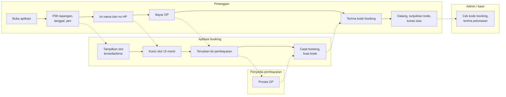

# Analisis Kebutuhan

**Topik:** Perancangan antarmuka proses pemesanan jadwal dan pembayaran uang muka (DP)
pada komputerisasi aplikasi booking lapangan futsal.

Dokumen ini mengikuti tiga langkah praktis analisis kebutuhan:

1. Studi / identifikasi awal
2. Sintesa alur proses dalam sistem yang melibatkan piranti komputasi
3. Pemetaan spesifik tiap proses dan prosedur (prioritas fitur, alur prosedur, komponen antarmuka)

Hasilnya dirangkum sebagai kebutuhan fungsional, non-fungsional, dan kontekstual (bagian 4),
sebelum masuk ke wireframe dan prototype.

> **Catatan istilah.** Di dokumen ini, **sistem** berarti keseluruhan mekanisme kerja penyewaan
> lapangan futsal (orang, aturan, jadwal, uang, dan alat). **Aplikasi booking** hanyalah satu
> piranti komputasi di dalam sistem itu, bukan sistemnya.

---

## 1. Studi / Identifikasi Awal

### 1.1 Peruntukan komputerisasi

Aplikasi booking dipakai **pelanggan** untuk memesan jadwal lapangan dan membayar DP **secara
mandiri**, tanpa harus menunggu admin lapangan membalas chat.

### 1.2 Sistem kerja penyewaan lapangan dan pihak yang terlibat

| Pihak | Peran dalam sistem | Berinteraksi dengan aplikasi? |
|---|---|---|
| Pelanggan (pemesan) | Memilih jadwal, membayar DP, datang dan melunasi | **Ya**, pengguna utama yang dirancang |
| Admin / kasir lapangan | Mengatur jadwal, menerima pelunasan, mengecek kode booking | Ya, tetapi lewat sisi admin (di luar ruang lingkup) |
| Penyedia pembayaran (QRIS, bank, e-wallet) | Memproses pembayaran DP | Tidak langsung; aplikasi meneruskan pembayaran |
| Teman satu tim | Ikut bermain, menerima info jadwal | Tidak; hanya menerima bukti booking yang dibagikan |

### 1.3 Mekanisme kerja saat ini (tanpa aplikasi)

1. Pelanggan mengirim chat WhatsApp ke admin menanyakan jadwal kosong.
2. Admin mengecek buku atau catatan jadwal, lalu membalas.
3. Jika jam yang diinginkan terisi, tanya-jawab diulang.
4. Pelanggan mentransfer DP dan mengirim foto bukti transfer.
5. Admin mengecek mutasi rekening secara manual, mencatat jadwal, lalu mengonfirmasi.
6. Pada hari main, pelanggan datang dan melunasi sisa biaya.

### 1.4 Masalah yang ditemukan

- **Lambat:** pelanggan menunggu balasan admin, apalagi di jam sibuk.
- **Tidak transparan:** pelanggan tidak bisa melihat sendiri jam mana yang kosong.
- **Rawan bentrok:** dua orang bisa dijanjikan jam yang sama sebelum admin mencatat.
- **Verifikasi manual:** bukti transfer dicek satu per satu dan bisa terlewat.

### 1.5 Sumber data

- Pengalaman pribadi dan observasi saat booking lapangan futsal.
- Wawancara singkat dengan 3-5 orang yang rutin bermain futsal (direncanakan).
- Pembanding: pola umum aplikasi pemesanan jadwal (lapangan olahraga, tiket, reservasi).

---

## 2. Sintesa Alur Proses dalam Sistem

### 2.1 Perbandingan langkah sebelum dan sesudah komputerisasi

| Langkah dalam sistem | Sebelum (manual) | Sesudah (dengan aplikasi) | Piranti komputasi |
|---|---|---|---|
| Mencari jam kosong | Tanya admin lewat chat | Lihat grid jadwal di aplikasi | **Aplikasi** |
| Memesan jam | Admin mencatat di buku | Pelanggan memilih slot sendiri | **Aplikasi** |
| Mencegah bentrok | Bergantung ketelitian admin | Slot dikunci otomatis 15 menit | **Aplikasi** |
| Membayar DP | Transfer, kirim foto bukti | QRIS / VA / e-wallet dari aplikasi | **Aplikasi** + penyedia pembayaran |
| Verifikasi pembayaran | Admin cek mutasi manual | Status diperbarui otomatis | **Aplikasi** + penyedia pembayaran |
| Bukti pemesanan | Chat konfirmasi admin | Kode booking di aplikasi | **Aplikasi** |
| Pelunasan dan check-in | Bayar di kasir | Tunjukkan kode, bayar di kasir | Di luar ruang lingkup |

### 2.2 Alur proses dalam sistem

### 2.3 Batas ruang lingkup

- **Dirancang (2 proses):** pemesanan jadwal dan pembayaran DP, dari sisi pelanggan.
- **Tidak dirancang:** registrasi/login, pelunasan di lokasi, check-in oleh petugas,
  pembatalan setelah lunas DP, dan seluruh sisi admin.

---

## 3. Pemetaan Spesifik Proses dan Prosedur

### 3.1 Prioritas fitur (metode MoSCoW)

| Prioritas | Fitur | Kode kebutuhan |
|---|---|---|
| **Must have** (wajib) | Lihat ketersediaan slot, pilih slot, hitung harga otomatis | F-03, F-04, F-05 |
| | Ringkasan pesanan dan data pemesan | F-06, F-07 |
| | Kunci slot sementara | F-08 |
| | Pilih metode bayar dan instruksi pembayaran | F-10, F-11 |
| | Bukti booking dengan kode | F-15 |
| **Should have** (sebaiknya ada) | Hitung mundur batas bayar | F-13 |
| | Penanganan bayar gagal dan waktu habis | F-17, F-18 |
| | Pemberitahuan slot direbut orang lain | F-09 |
| | Konfirmasi sebelum membatalkan pembayaran | F-19 |
| **Could have** (bagus kalau ada) | Salin nomor VA satu ketukan | F-12 |
| | Simpan / bagikan bukti booking | F-16 |
| **Won't have** (tidak dibuat sekarang) | Login, pembatalan dan refund, pilih jadwal berulang mingguan, sisi admin | - |

### 3.2 Alur prosedur tiap proses

**Proses 1: Pemesanan jadwal**

| No | Prosedur | Input | Aturan | Output |
|---|---|---|---|---|
| 1.1 | Pilih lapangan | Ketukan pada kartu lapangan | - | Lapangan terpilih |
| 1.2 | Pilih tanggal | Ketukan pada tanggal | Hari ini sampai 6 hari ke depan | Jadwal tanggal itu tampil |
| 1.3 | Pilih jam | Ketukan pada slot | Hanya slot tersedia; beberapa slot harus berurutan | Daftar jam + total harga |
| 1.4 | Periksa ringkasan | - | Tarif 18.00 ke atas Rp150.000/jam, sebelumnya Rp100.000/jam; DP 50% | Total, DP, sisa |
| 1.5 | Isi data pemesan | Nama, nomor HP | Nama minimal 2 huruf; HP diawali 08, 10-13 angka | Data valid |
| 1.6 | Lanjut bayar | Ketukan tombol | Slot dikunci 15 menit; jika slot sudah diambil orang, kembali ke 1.3 | Pesanan menunggu pembayaran |

**Proses 2: Pembayaran DP**

| No | Prosedur | Input | Aturan | Output |
|---|---|---|---|---|
| 2.1 | Pilih metode | QRIS / VA / e-wallet | Satu metode | Metode terpilih |
| 2.2 | Ikuti instruksi | Pembayaran di aplikasi bank/e-wallet | Nominal harus sama dengan DP | Pembayaran terkirim |
| 2.3 | Cek status | Ketukan tombol / otomatis | Sebelum waktu kunci habis | Berhasil / gagal |
| 2.4a | Jika berhasil | - | - | Kode booking dan bukti |
| 2.4b | Jika gagal | Coba lagi / ganti metode | Slot tetap dikunci selama sisa waktu | Kembali ke 2.1 atau 2.2 |
| 2.4c | Jika waktu habis | - | Slot dilepas, tidak ada tagihan | Kembali ke 1.3 |

### 3.3 Komponen antarmuka yang dibutuhkan

| Layar | Komponen |
|---|---|
| Beranda | Tombol utama "Booking Lapangan" (kartu besar), daftar booking aktif, keadaan kosong (empty state) |
| Pilih Lapangan | Kartu lapangan (foto, nama, jenis lantai, harga mulai) |
| Pilih Jadwal | Deretan chip tanggal (geser horizontal), legenda status, grid slot jam 3 kolom, ringkasan total di bawah, tombol "Lanjut" |
| Ringkasan Pesanan | Daftar detail (label-nilai), rincian harga, kolom isian nama dan HP, pesan error di bawah kolom, tombol berisi nominal DP |
| Pilih Metode Bayar | Bilah hitung mundur kunci, kartu pilihan metode (radio), ringkasan DP |
| Instruksi Pembayaran | Hitung mundur besar, nominal, kode QR / nomor VA + tombol "Salin" / tombol buka e-wallet, langkah bernomor, dialog konfirmasi batal |
| Booking Berhasil | Ikon sukses, kartu tiket dengan kode booking besar, tombol simpan bukti |
| Gagal / Waktu Habis | Ikon status, pesan penyebab dan solusi, tombol tindakan |
| Semua layar | Bilah atas dengan tombol kembali, notifikasi singkat (toast) |

---

## 4. Hasil Analisis: Jenis Kebutuhan

### 4.1 Kebutuhan Fungsional

Fitur dan tindakan utama yang ingin dilakukan pengguna.

#### A. Proses pemesanan jadwal

| Kode | Kebutuhan | Layar |
|---|---|---|
| F-01 | Pengguna dapat melihat daftar lapangan beserta jenis lantai dan harga mulai | Pilih Lapangan |
| F-02 | Pengguna dapat memilih tanggal main (hari ini sampai 6 hari ke depan) | Pilih Jadwal |
| F-03 | Pengguna dapat melihat ketersediaan setiap slot jam: tersedia, terisi, atau sudah lewat | Pilih Jadwal |
| F-04 | Pengguna dapat memilih satu atau beberapa slot jam berurutan | Pilih Jadwal |
| F-05 | Aplikasi menghitung total harga otomatis sesuai tarif siang dan malam | Pilih Jadwal |
| F-06 | Pengguna dapat melihat ringkasan pesanan: jadwal, rincian harga, DP, dan sisa pelunasan | Ringkasan Pesanan |
| F-07 | Pengguna dapat mengisi nama dan nomor HP, dengan pemeriksaan format nomor HP | Ringkasan Pesanan |
| F-08 | Aplikasi mengunci slot yang dipilih selama 15 menit setelah pengguna lanjut ke pembayaran | Ringkasan Pesanan |
| F-09 | Aplikasi memberi tahu jika slot keburu dipesan pengguna lain, lalu mengarahkan memilih ulang | Pilih Jadwal |

#### B. Proses pembayaran DP

| Kode | Kebutuhan | Layar |
|---|---|---|
| F-10 | Pengguna dapat memilih metode bayar: QRIS, transfer virtual account, atau e-wallet | Pilih Metode Bayar |
| F-11 | Pengguna dapat melihat instruksi pembayaran sesuai metode yang dipilih | Instruksi Pembayaran |
| F-12 | Pengguna dapat menyalin nomor virtual account dengan satu ketukan | Instruksi Pembayaran |
| F-13 | Pengguna dapat melihat sisa waktu pembayaran (hitung mundur) | Metode Bayar, Instruksi Pembayaran |
| F-14 | Pengguna dapat mengecek status pembayaran | Instruksi Pembayaran |
| F-15 | Pengguna menerima bukti booking berisi kode booking, detail jadwal, dan sisa pelunasan | Booking Berhasil |
| F-16 | Pengguna dapat menyimpan bukti booking | Booking Berhasil |
| F-17 | Jika pembayaran gagal, pengguna dapat mencoba lagi atau mengganti metode | Pembayaran Gagal |
| F-18 | Jika waktu habis, aplikasi melepas slot dan mengarahkan pengguna memilih jadwal lagi | Waktu Bayar Habis |
| F-19 | Pengguna dapat membatalkan pembayaran setelah melewati konfirmasi | Instruksi Pembayaran |

---

### 4.2 Kebutuhan Non-Fungsional

Kualitas interaksi dan pengalaman pengguna.

| Kode | Aspek | Kebutuhan | Penerapan di desain |
|---|---|---|---|
| NF-01 | Kecepatan respons | Perubahan pilihan slot dan total harga tampil seketika (di bawah 1 detik) setelah diketuk | Total di bagian bawah layar Pilih Jadwal langsung berubah |
| NF-02 | Kecepatan tugas | Booking selesai dalam 7 layar, sekitar 2 menit, tanpa menunggu balasan admin | Alur 7 layar tanpa langkah login di dalam proses |
| NF-03 | Keterbacaan teks | Teks isi minimal 14-15 px, teks kecil minimal 11 px; kontras teks dan latar minimal 4,5:1 (WCAG AA) | Angka penting (total, DP, kode booking, hitung mundur) ditulis lebih besar dan tebal |
| NF-04 | Responsivitas layar | Tampilan tetap utuh di lebar layar HP 360-430 px, tanpa geser ke samping; mendukung mode gelap | Satu kolom, grid jam 3 kolom, warna berbasis tema |
| NF-05 | Aksesibilitas | Target sentuh minimal 44 x 44 px; status tidak hanya dibedakan warna; setiap kolom isian punya label; fokus keyboard terlihat | Slot terisi diberi arsir, coretan, dan label "Terisi" |
| NF-06 | Kejelasan biaya | Total, DP, dan sisa pelunasan tampil sebelum pengguna membayar | Rincian harga di layar Ringkasan; nominal DP tertulis di tombol |
| NF-07 | Pencegahan kesalahan | Pengguna tidak bisa lanjut dengan data salah atau slot yang tidak tersedia | Tombol nonaktif sampai data valid; slot terisi tidak bisa dipilih |
| NF-08 | Pemulihan kesalahan | Setiap pesan gagal menyebut penyebab dan jalan keluarnya | Layar Pembayaran Gagal dan Waktu Habis punya tombol tindakan |
| NF-09 | Keamanan data | Data pribadi yang diminta seminimal mungkin (nama dan nomor HP); aplikasi tidak menyimpan data kartu | Pembayaran diteruskan ke QRIS, bank, atau e-wallet |

---

### 4.3 Kebutuhan Kontekstual

Kondisi saat aplikasi dipakai.

#### Perangkat yang digunakan
- **Smartphone Android kelas menengah**, layar sekitar 6 inci, karena itu perangkat yang paling umum dipakai mahasiswa dan pekerja muda.
- **Sering dipakai satu tangan**, misalnya sambil berjalan atau di atas motor saat berhenti.
  Akibatnya, tombol utama diletakkan di bagian bawah layar agar terjangkau ibu jari.

#### Waktu penggunaan
- **Sore sampai malam**, setelah jam kuliah atau kerja, saat pengguna mengatur jadwal main bersama teman.
- **Jadwal malam (18.00 ke atas) paling diburu**, sehingga slot cepat habis dan rawan bentrok.
  Akibatnya, aplikasi perlu kunci slot 15 menit dan pemberitahuan kalau slot direbut orang lain.
- **Sering mendadak** (hari H atau H-1).
  Akibatnya, pilihan "Hari ini" diletakkan paling depan, dan jam yang sudah lewat ditandai.

#### Lokasi dan koneksi
- Dipakai di kos, kampus, atau di jalan dengan **koneksi internet yang tidak selalu stabil**.
  Akibatnya, status pembayaran harus jelas, dan pesanan tidak langsung hilang saat pembayaran gagal (slot tetap dikunci selama sisa waktu).

#### Tingkat literasi digital pengguna
- **Pengguna utama:** mahasiswa dan pekerja muda usia 18-35 tahun, terbiasa memakai e-wallet, QRIS, dan aplikasi pemesanan online.
- **Kebiasaan sebelumnya:** booking lewat chat WhatsApp ke admin lapangan.
  Masalahnya: balasan lambat, jadwal ternyata sudah terisi, dan bukti transfer dikirim manual.
- **Satu orang biasanya memesan untuk satu tim.**
  Akibatnya, bukti booking harus mudah disimpan dan dibagikan ke teman satu tim.
- **Akibat untuk desain:** bahasa dibuat sederhana dan sehari-hari ("Pilih jam", "Bayar DP"), istilah teknis dihindari, dan alur dibuat lurus tanpa banyak cabang.

---

## 5. Catatan

- Harga, persentase DP (50%), dan lama kunci slot (15 menit) adalah **asumsi** untuk keperluan perancangan.
- Kebutuhan kontekstual sebaiknya **divalidasi** dengan wawancara singkat ke 3-5 orang yang rutin bermain futsal.
