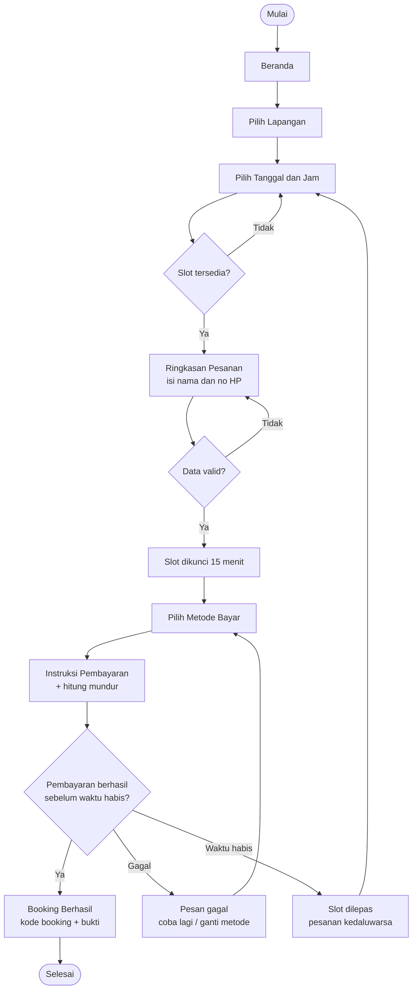

# User Flow: Pemesanan Jadwal dan Pembayaran Uang Muka (DP)

Aplikasi booking lapangan futsal

## 1. Ruang lingkup

Dokumen ini hanya membahas **dua proses** (sesuai ketentuan 1-2 proses):

1. **Pemesanan jadwal**: memilih lapangan, tanggal, dan jam main.
2. **Pembayaran uang muka (DP)**: membayar sebagian biaya agar jadwal terkunci.

Di luar ruang lingkup: registrasi/login, pelunasan di lokasi, pembatalan, ulasan.

## 2. Pengguna (persona singkat)

**Rizal, 21 tahun, mahasiswa.** Rutin main futsal bareng teman tiap minggu.
Biasanya booking lewat chat WhatsApp ke admin lapangan, sering dibalas lama
dan jadwal yang diinginkan ternyata sudah terisi.

**Tujuan:** dapat jadwal main yang pasti dalam waktu singkat, tanpa harus
menunggu balasan admin.

## 3. Alur utama (happy path)

| No | Layar | Aksi pengguna | Respons sistem |
|---|---|---|---|
| 1 | Beranda | Ketuk "Booking Lapangan" | Tampilkan daftar lapangan |
| 2 | Pilih Lapangan | Pilih lapangan (mis. Lapangan A, rumput sintetis) | Tampilkan jadwal lapangan tersebut |
| 3 | Pilih Jadwal | Pilih tanggal, lalu pilih slot jam yang tersedia | Slot terisi ditandai abu-abu dan tidak bisa dipilih; harga dihitung otomatis |
| 4 | Ringkasan Pesanan | Periksa detail, isi nama dan nomor HP, ketuk "Lanjut Bayar DP" | Slot dikunci sementara (15 menit) |
| 5 | Pilih Metode Bayar | Pilih QRIS / transfer bank (VA) / e-wallet | Tampilkan instruksi pembayaran |
| 6 | Instruksi Pembayaran | Bayar sesuai nominal DP | Tampilkan hitung mundur sisa waktu bayar |
| 7 | Booking Berhasil | Lihat bukti booking | Tampilkan kode booking, detail jadwal, sisa pelunasan |

## 4. Diagram alur

## 5. Alur alternatif dan kondisi khusus

| Kondisi | Yang terjadi | Penanganan di antarmuka |
|---|---|---|
| Slot sudah terisi | Pengguna tidak bisa memilihnya | Slot berwarna abu-abu dengan label "Terisi" |
| Slot direbut pengguna lain saat masih di ringkasan | Kunci gagal dibuat | Pesan "Jadwal baru saja dipesan orang lain", kembali ke Pilih Jadwal |
| Nomor HP tidak valid | Tidak bisa lanjut | Pesan error di bawah kolom, tombol "Lanjut" tetap nonaktif |
| Pembayaran gagal | DP belum masuk | Pesan gagal, tombol "Coba Lagi" dan "Ganti Metode" |
| Waktu bayar habis (15 menit) | Slot dilepas | Pesan kedaluwarsa, tombol "Pilih Jadwal Lagi" |
| Pengguna menekan kembali saat bayar | Risiko kehilangan pesanan | Dialog konfirmasi "Batalkan pembayaran?" |

## 6. Aturan bisnis (asumsi)

- Durasi sewa per slot: 1 jam, bisa pilih beberapa slot berurutan.
- Harga contoh: Rp100.000/jam (siang), Rp150.000/jam (malam, mulai 18.00).
- DP: 50% dari total harga. Sisa dilunasi di lokasi sebelum main.
- Slot dikunci 15 menit sejak pengguna menekan "Lanjut Bayar DP".

## 7. Catatan usability per langkah

- **Pilih Jadwal:** jadwal ditampilkan sebagai grid jam agar ketersediaan
  terlihat sekilas; tidak perlu mencoba satu per satu.
- **Ringkasan:** semua angka (total, DP, sisa) ditampilkan sebelum bayar,
  supaya tidak ada biaya mengejutkan.
- **Pembayaran:** hitung mundur terlihat jelas, sehingga pengguna paham ada
  batas waktu.
- **Bukti booking:** kode booking besar dan mudah ditunjukkan ke petugas;
  ada tombol simpan/bagikan.
